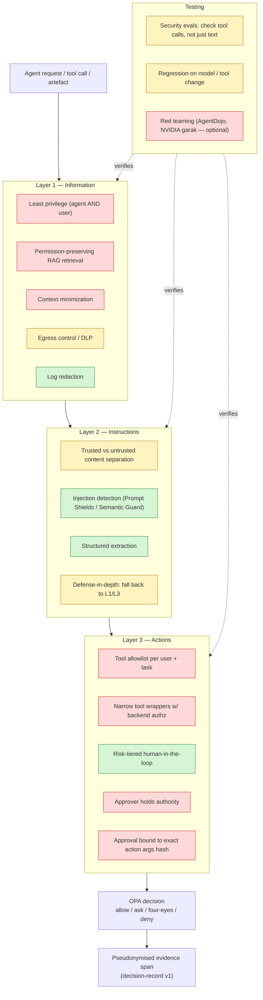

# Agent security framework mapping

This maps **AI Compliance Automation (ACA)** onto a three-layer model for securing
AI agents — **Information**, **Instructions**, **Actions** — plus a **Testing**
discipline. ACA is the contextual *slow path* next to the deterministic Agent
Access Governance Gateway (the PEP); its core component is the **Semantic Guard**,
which emits *labels* while OPA decides `allow` / `ask` / `four-eyes` / `deny`.

**How to read the status column — this document does not over-claim.**

- **Implemented** — a control exists in ACA code *in this repo* and a named test proves it.
- **Partial** — ACA implements part of the control (often a *signal* or an advisory
  label), but enforcement, or the full control, lives elsewhere (the gateway) or is
  not finished here.
- **Gap** — ACA does not implement it. Roadmap owner named: the **Agent Hardening
  Sandbox** (a planned runtime-hardening sibling) or the **LLM Red-Teaming Pipeline**
  (`llm-red-teaming-pipeline`, a planned sibling).

Scope note: several Layer-1 and Layer-3 controls (tool allowlists, backend
authorization, per-user least privilege at call time) are the **gateway's**
responsibility. The gateway is a separate repo and is *out of scope* for ACA; where
a control is "done, but by the gateway", ACA's status is **Gap (ACA)** with a note,
because this table rates *what ACA's own code does*. ACA integrates with the gateway
over the `POST /v1/labels` contract; it does not re-implement the PEP.

Lab / portfolio project. Synthetic data only. Mappings are illustrative, not a
conformity claim.

---

## Layer diagram

Legend: green = Implemented, amber = Partial, red = Gap (see each row for the exact
basis and the roadmap owner).

---

## Layer 1 — Information

| Control | ACA component / file | Test that proves it | Status |
|---|---|---|---|
| **Least privilege (agent AND end user)** | ACA normalises identity to `{subject_id, groups, site}` (`src/aca/identity/provider.py`) and carries `groups`/`site` into the decision record, but it does **not** enforce per-user/agent least privilege at tool-call time — that is the gateway's allowlist + group check. | `tests/test_identity.py::test_fixture_provider_is_default_and_available`, `::test_entra_provider_normalises_group_claims_when_configured` (identity normalisation only) | **Gap (ACA)** — enforcement is the gateway's; ACA only supplies normalised identity. Runtime least-privilege enforcement → **Agent Hardening Sandbox**. |
| **Permission-preserving RAG retrieval** | Not implemented. ACA classifies prompts/tool-calls/artefacts; it has no retrieval layer and does not filter retrieved documents by the end user's permissions. | — | **Gap** → **Agent Hardening Sandbox**. |
| **Context minimization** | Partial as a side effect: the session store keeps **labels only**, never raw prompt text, and evicts on TTL (`src/aca/guard/stages/stage_s.py`); the Guard treats request text as in-memory-only and never persists it (`src/aca/guard/api/app.py`). There is no deliberate context-trimming of what the agent model sees. | `tests/test_stage_s.py::test_stores_labels_only_not_raw_text`, `::test_ttl_expiry_drops_old_labels`, `::test_summary_returns_no_prompt_text` | **Partial** — session/evidence minimization only; model-context trimming → **Agent Hardening Sandbox**. |
| **Egress control / DLP** | Partial, signals only: stage 0 flags PII (email / employee-id / IBAN) and secrets, and reads a tool `data_class` tag (`src/aca/guard/stages/stage0.py`); the fail-safe classifier treats `exfil`/`sensitive`/`write` tool classes as fail-safe-to-ask (`src/aca/guard/failsafe/policy.py`). ACA does **not** block or rewrite egress — it labels, and OPA/the gateway act. | `tests/test_stage0.py::test_detects_pii_and_secret`, `::test_data_class_from_tool_metadata`; `tests/test_failsafe.py::test_risky_class_degrades_to_ask` | **Partial** — detection + routing signals; actual egress blocking/DLP enforcement → **Agent Hardening Sandbox**. |
| **Log redaction** | Implemented: evidence spans carry a **salted pseudonymised** subject and approvers, args reduced to key names + count + SHA-256 (never raw values), and a build-time check rejects clear-identity / raw-content fields (`src/aca/guard/evidence/redact.py`, `src/aca/guard/evidence/record.py`). | `tests/test_evidence.py::test_subject_is_pseudonymised_not_clear`, `::test_args_reduced_to_names_count_hashes_no_raw_values`, `::test_forbidden_fields_rejected`, `::test_approvers_pseudonymised` | **Implemented**. |

---

## Layer 2 — Instructions

| Control | ACA component / file | Test that proves it | Status |
|---|---|---|---|
| **Trusted vs untrusted content separation** | Partial: the `Event` type separates user `text` from an `artefact` (diff/document) field (`src/aca/guard/event.py`), and Prompt Shields analyses the user prompt and documents separately (`userPromptAnalysis` vs `documentsAnalysis` in `src/aca/guard/adapters/prompt_shields.py`). ACA does **not** cryptographically label or enforce provenance/trust of each content segment. | `tests/test_prompt_shields.py::test_attack_detected_emits_separate_concept_label` | **Partial** — field-level separation + per-segment injection scan; enforced trust boundaries → **Agent Hardening Sandbox**. |
| **Injection detection (Prompt Shields / Semantic Guard)** | Implemented (hybrid, feature-flagged): the Prompt Shields adapter detects jailbreak/injection and emits a **separate** `PROMPT-INJECTION` label — never a legal verdict, scored separately (`src/aca/guard/adapters/prompt_shields.py`). Absent creds → clean skip; timeout/401/403/429/5xx → raises → fail-safe `ask`. The local Semantic Guard (`stage0`/`stage1`) targets legal-element intent, not injection. | `tests/test_prompt_shields.py::test_attack_detected_emits_separate_concept_label`, `::test_absent_credentials_degrade_to_empty`, `::test_http_errors_raise_for_failsafe`, `::test_timeout_raises_for_failsafe`; `tests/test_hybrid_wiring.py::test_vendor_signal_scored_separately_from_legal_concept` | **Implemented** (optional adapter; off without Azure creds). |
| **Structured extraction** | Implemented (hybrid, off by default): the stage-3 judge uses a pinned rubric and returns strict JSON (`{concept_id, elements[], confidence}`) parsed into labels with quoted-span evidence (`src/aca/guard/adapters/judge.py`); the label schema itself is structured and verdict-free (`src/aca/guard/labels/schema.py`). | `tests/test_judge.py::test_stub_judge_detects_elements_and_emits_label`, `::test_judge_parses_quoted_spans_as_evidence`, `::test_live_backend_parses_structured_json` | **Implemented** (judge is off by default; the stub proves the path offline). |
| **Defense-in-depth: fall back to Layer 1/3 controls** | Partial: if the Guard (incl. the injection adapter) is unavailable or every adapter fails, the pipeline applies the **fail-safe tier** (`risky`/unknown → `ask`, never a silent allow) rather than relying on the compromised layer (`src/aca/pipeline.py`, `src/aca/guard/failsafe/policy.py`). This is fallback *to a human review tier*; it does not fall back to an independent Layer-1 egress block or Layer-3 allowlist (those are the gateway / not built). | `tests/test_failsafe.py::test_no_silent_allow_for_risky`, `::test_label_with_health_reports_unhealthy_when_all_adapters_fail`; `tests/test_pipeline.py::test_guard_failure_records_failsafe_ask_not_silent_allow`; `tests/test_hybrid_wiring.py::test_vendor_failure_triggers_failsafe_ask_no_silent_allow` | **Partial** — fail-safe-to-ask is real; independent L1/L3 fallbacks → gateway / **Agent Hardening Sandbox**. |

---

## Layer 3 — Actions

| Control | ACA component / file | Test that proves it | Status |
|---|---|---|---|
| **Tool allowlist per user + task** | Not in ACA. The Guard reads tool metadata (`event.tool`) to classify, but there is no allowlist of permitted tools per user/task in this repo. This is the gateway's job. | — | **Gap (ACA)** — gateway responsibility; a repo-local allowlist is not built → **Agent Hardening Sandbox**. |
| **Narrow tool wrappers with backend authz** | Not in ACA. ACA does not wrap or proxy tools and performs no backend authorization check. | — | **Gap** → **Agent Hardening Sandbox**. |
| **Risk-tiered human-in-the-loop** | Implemented (as an advisory decision tier): OPA maps labels to `allow`/`ask`/`four-eyes`/`deny`; a full legal-element match routes to `four-eyes` regardless of confidence, a partial (≥2 of 3) to `ask`, and an unavailable Guard to `ask` for risky/unknown classes — never a silent allow (`policy/tier.rego`, `src/aca/policy/decide.py`, `src/aca/guard/failsafe/policy.py`). ACA produces the tier; the gateway enforces the pause. | `tests/test_policy_mirror.py::test_four_eyes_on_full_elements_even_at_low_confidence`, `::test_ask_on_partial_pattern_even_at_low_confidence`, `::test_deny_on_confirmed_pattern`; `tests/test_failsafe.py::test_risky_class_degrades_to_ask` | **Implemented** (ACA decides the tier; enforcement of the human gate is the gateway's). |
| **Approver must hold authority** | Partial, and only for **policy/interpretation changes**, not runtime actions: `.github/CODEOWNERS` requires the owning governance/ISMS/security teams to review changes to `requirements/`, `interpretations/`, `policy/`, `eval/`, so a confirmed-prohibited-pattern rule is enforceable only after an authorised, reviewed merge (`src/aca/review/recorder.py` refuses runtime policy writes). There is **no** runtime check that a *tool-action* approver holds authority over that action. | `tests/test_review.py::test_recorder_never_writes_policy_data`; `tests/test_review_replay.py::test_replay_denies_only_after_pattern_confirmed` | **Partial** — authority gate exists for policy changes (CODEOWNERS, PR-time); runtime action-approver authority → **Agent Hardening Sandbox**. |
| **Approval bound to exact action args hash** | Not implemented as an approval binding. ACA **does** compute a per-argument SHA-256 for the evidence record (`redact_args` in `src/aca/guard/evidence/redact.py`), and records `approver_pseudonyms`, but nothing binds an approval token to that args hash or rejects a mismatched replay. Do not read the evidence hash as an approval control. | `tests/test_evidence.py::test_args_reduced_to_names_count_hashes_no_raw_values` (evidence hashing only — **not** an approval binding) | **Gap** — args hashing exists only for evidence; binding approval ↔ exact args → **Agent Hardening Sandbox**. |

---

## Testing

| Control | ACA component / file | Test that proves it | Status |
|---|---|---|---|
| **Security evals check tool calls, not just text** | Partial: the eval runner scores the **routing decision** (the OPA tier / routed-to-review), not only label text, so it measures whether an attack would be stopped/escalated — closer to "what action results" than pure text classification (`src/aca/eval/runner.py`, metric `routed_to_review`). It does not drive a real agent executing real tool calls. | `tests/test_eval_runner.py::test_routed_to_review_is_at_least_strict_recall`, `::test_benign_false_block_stays_zero_and_routed_to_ask_reported` | **Partial** — decision/routing evals, not live tool-call evals → **LLM Red-Teaming Pipeline**. |
| **Regression on model / tool change** | Partial: every eval run records its embedding backend and git SHA, and a held-out set is scored separately so a model/vocab change shows up (`src/aca/eval/runner.py`, `eval/heldout/`, `eval/results/`); CI runs `opa test` + the full pytest suite on every change. There is no automatic golden-set gate that *fails* a PR when scores regress. | `tests/test_eval_runner.py::test_held_out_set_is_scored_separately`, `::test_runner_reports_per_language_and_provenance`; `tests/test_metrics_discipline.py::test_committed_latest_run_exists_and_has_provenance` | **Partial** — provenance + held-out + CI; an enforcing regression gate → **LLM Red-Teaming Pipeline**. |
| **Red teaming (AgentDojo, NVIDIA garak as optional starting points)** | Not integrated. The eval set includes synthetic attack/benign/ambiguous and a `PROMPT-INJECTION` set (`eval/cases/`, `eval/heldout/`), but no adversarial harness (AgentDojo, garak) drives it. | — | **Gap** → **LLM Red-Teaming Pipeline** (AgentDojo / NVIDIA garak are reasonable starting points). |

---

## Summary

| Layer | Implemented | Partial | Gap |
|---|---|---|---|
| 1 — Information | Log redaction | Context minimization; Egress/DLP (signals) | Least privilege (ACA); Permission-preserving RAG |
| 2 — Instructions | Injection detection; Structured extraction | Trusted/untrusted separation; Defense-in-depth fallback | — |
| 3 — Actions | Risk-tiered human-in-the-loop (tier) | Approver authority (policy changes only) | Tool allowlist; Narrow wrappers + backend authz; Approval↔args-hash binding |
| Testing | — | Tool-call/routing evals; Model/tool regression | Red-teaming harness (AgentDojo / garak) |

**Roadmap owners.** Runtime-hardening gaps (least privilege enforcement, RAG permission filtering, egress blocking, tool allowlist, narrow tool wrappers + backend authz, action-approver authority, approval↔args-hash binding) belong to a planned **Agent Hardening Sandbox**. Adversarial testing gaps (red-teaming harness, enforcing regression gate, live tool-call evals) belong to the planned **LLM Red-Teaming Pipeline** (`llm-red-teaming-pipeline`). Neither sibling is implemented in this repo.

*Every row was checked against the code on branch `spec`. Where a control is the
gateway's responsibility, ACA is marked Gap (ACA) rather than credited, because this
table rates ACA's own code.*
